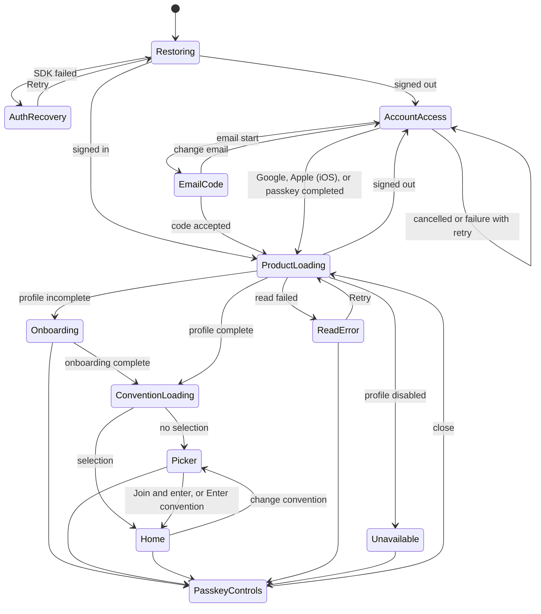

# Native account-access capability contract

Status: draft for issue #476. An independent security review found no blocking issue on 2026-11-05, and this version includes its fixes. It becomes accepted after the owner approves it. The parent Feature is #475.

This spec records what the pinned native Clerk SDKs can do for each account-access method on Android and iOS. It also freezes the TailTag auth operations, results, and failure categories that #477 to #480 implement. It records the Clerk Development configuration that those issues need, and who applies each change.

This spec changes no code and no external configuration. ADR 0009 still holds. The only ADR change is a short note about browser OAuth (see [Approvals](#approvals)).

## Terms

- A pin is the exact SDK version that the app builds against.
- A first factor is the credential that starts a sign-in, such as an email code or a passkey.
- A transfer is the Clerk step that turns a provider sign-in with no account into a new account.
- An external account is a Google or Apple identity that Clerk links to a user.
- The Frontend API host is the Clerk domain that serves one Clerk instance.
- A relying party ID is the domain that a passkey belongs to.
- An association file proves that an app can use a domain. iOS uses `apple-app-site-association`. Android uses `assetlinks.json`.

## Pins and evidence sources

| Platform | Pin | Exact source used |
| --- | --- | --- |
| iOS | ClerkKit `1.6.1` | clerk-ios tag `1.6.1`, commit `173d9382073d6a7a9b439c1e810c42c9ec77a25f` |
| Android | clerk-android-api `1.2.1` | `clerk-android-api-1.2.1.aar`, SHA-256 `bb6221bf80ea1b1ec04f8c378d0cbceb056a340c64b9b7724babc1d758224cc3` |

iOS citations are paths under `Sources/ClerkKit/` at that commit. Android citations are `javap -public` signatures and Kotlin metadata from that AAR. No citation uses another SDK version.

The compile probe is described in [Compile probe record](#compile-probe-record).

## Capability matrix

Status values:

- Supported: the pinned source and the compile probe prove the call.
- Unproved: a fact needs live proof. The last column names the issue.
- Out of scope by owner decision: the owner removed it from this milestone.

### iOS (ClerkKit 1.6.1)

| Operation | Status | Evidence | Live proof |
| --- | --- | --- | --- |
| Email sign-up | Supported | `Core/Auth.swift:395` `signUp(emailAddress:...)`, `Domains/Auth/SignUp/SignUp.swift:198` `sendEmailCode()`, `:223` `verifyEmailCode(_:)` | #477 |
| Email sign-in | Supported | `Core/Auth.swift:106` `signInWithEmailCode(emailAddress:)`, `Domains/Auth/SignIn/SignIn.swift:183` `verifyCode(_:)` | #477 |
| Code resend | Supported | `SignIn.swift:99` `sendEmailCode(emailAddressId:)`, `SignUp.swift:198` `sendEmailCode()` | #477 |
| Google | Supported | `Core/Auth.swift:153` `signInWithOAuth(provider:prefersEphemeralWebBrowserSession:transferable:unsafeMetadata:)`. It opens an SDK-owned browser session (`Utils/WebAuthentication.swift`). | #478 |
| Apple | Supported | `Core/Auth.swift:229` `signInWithApple(requestedScopes:transferable:unsafeMetadata:)`. It uses the native Apple sheet (`Core/Auth+Apple.swift:33`). | #479 |
| Passkey capability check | Supported | iOS 17 is above the platform passkey minimum. The app always tries and maps a refusal (see [Device and OS rules](#device-and-os-rules)). | #480 |
| Passkey sign-in | Supported | `Core/Auth.swift:259` `createPasskeySignIn()` and `:271` `signInWithPasskey()`. These are first-factor calls. | #480 |
| Passkey creation | Supported | `Domains/User/User.swift:353` `createPasskey()` | #480 |
| Passkey listing | Supported | `User.swift:89` `passkeys`. Fields: `Domains/Auth/Passkey/Passkey.swift:11` `id`, `:14` `name`, `:20` `createdAt`, `:26` `lastUsedAt` | #480 |
| Passkey removal | Supported | `Passkey.swift:88` `delete()` | #480 |

### Android (clerk-android-api 1.2.1)

| Operation | Status | Evidence | Live proof |
| --- | --- | --- | --- |
| Email sign-up | Supported | `Auth.signUp(Function1<SignUpBuilder>)` with `SignUpBuilder.setEmail`, `SignUpKt.sendEmailCode(SignUp)`, `verifyCode(SignUp, String, VerificationType)` | #477 |
| Email sign-in | Supported | `Auth.signInWithOtp(Function1<SignInWithOtpBuilder>)`, `verifyCode(SignIn, String)`. The current bridge already uses both. | #477 |
| Code resend | Supported | `SignInKt.sendEmailCode(SignIn, String)`, `SignUpKt.sendEmailCode(SignUp)` | #477 |
| Google | Supported | `Auth.signInWithGoogleOneTap(boolean)` returns `ClerkResult<OAuthResult>`. It uses Credential Manager. The AAR depends on `androidx.credentials` and `com.google.android.libraries.identity.googleid`. | #478 |
| Apple | Out of scope by owner decision | See [Parent-contract changes](#parent-contract-changes). | None |
| Passkey capability check | Supported | No passkey class in the AAR has an API-level guard. The app owns the guard (see [Device and OS rules](#device-and-os-rules)). | #480 |
| Passkey sign-in | Supported | `Auth.signInWithPasskey(boolean)`. Kotlin metadata names the parameter `preferImmediatelyAvailableCredentials`. It is a first-factor call. | #480 |
| Passkey creation | Supported | `UserKt.createPasskey(User)` | #480 |
| Passkey listing | Supported | `User.getPasskeys()`. Fields: `Passkey.getId`, `getName`, `getCreatedAt`, `getLastUsedAt` | #480 |
| Passkey removal | Supported | `PasskeyKt.delete(Passkey)` | #480 |

Kotlin metadata for `Auth` names the `signInWithOAuth` parameters `provider`, `transferable`, and `redirectUrl`. The Android compile probe called `signInWithGoogleOneTap(transferable = true)`, `signInWithOAuth(provider = ..., transferable = true)`, and `signInWithPasskey(preferImmediatelyAvailableCredentials = true)` with these names.

On Android, `User.emailAddresses` and `User.externalAccounts` are nullable lists. The compile probe found this. Code treats a null list as empty.

### Facts that stay unproved

| Fact | Why it is unproved | Issue that settles it |
| --- | --- | --- |
| Whether `createPasskey` needs reverification | Clerk lists adding and removing a passkey as sensitive actions. The Development instance has reverification on. The #480 live proof records the real error code (see [Passkey additions](#passkey-additions)). | #480 live proof |
| Whether registering the native apps fills the Clerk-served association files | The Apple file lists the iOS app since #479. The Android file stays empty until the owner registers the Android app (see [Association file check](#association-file-check)). | #480 live proof |
| Credential Manager cancellation types for passkeys on Android | Settled by #480: Clerk marks a passkey cancellation with `shouldSuppressCredentialFlowError`, as for Google (see [Passkey additions](#passkey-additions)). | Settled |
| Exact Clerk error codes other than `form_identifier_not_found` and `form_code_incorrect` | Only those two appear in pinned source (`ClerkKitUI`). The #480 live proof records the passkey codes. | #477, #480 live proof |

## Device and OS rules

TailTag keeps Android API 26+ and iOS 17+. One build serves every supported device.

| Platform | Rule |
| --- | --- |
| Android | The app offers passkeys only when `Build.VERSION.SDK_INT >= 28`. Clerk's Android passkey guide requires Android 9+. API 26 and 27 devices see the unavailable state. |
| Both | The app also offers passkeys only while Clerk has passkey sign-in on as a first factor. Otherwise the device sees the unavailable state. |
| Android | Clerk states that passkeys do not work on Android emulators. Passkey proof needs a physical device. |
| iOS | Every supported iOS version (17+) can use passkeys. The app always offers them. |
| Both | Any platform refusal maps to `passkeyUnavailable`. The app then shows the limitation and offers email and Google, plus Apple on iOS. |

#480 proves the capable state on a physical Android phone and a physical iPhone. The owner approved a change on 2026-11-06 (#480 G9). An API 27 Android emulator proves the native device check. Widget tests prove the unavailable screens. No physical API 26 or 27 phone is available.

## Frozen TailTag auth contract

The contract extends `AuthSession`, `AuthState`, and `AuthFailure` in `lib/core/auth/`. Product features still receive no Clerk type, token, provider credential, or channel type. #477 adds the code. This spec adds no Dart code.

### Operations

| Operation | Returns | Can throw |
| --- | --- | --- |
| `startEmailSignIn(emailAddress)` | Nothing. A code is sent. | `accountNotFound`, `rateLimited`, `connectivity`, `unexpected` |
| `startEmailSignUp(emailAddress)` | Nothing. A code is sent. | `accountExists`, `rateLimited`, `connectivity`, `unexpected` |
| `resendEmailCode()` | Nothing. | `rateLimited`, `sessionEnded`, `connectivity`, `unexpected` |
| `verifyEmailCode(code)` | `AuthAttemptResult` | `invalidCode`, `sessionEnded`, `connectivity`, `unexpected` |
| `continueWithGoogle()` | `AuthAttemptResult` | `providerUnavailable`, `connectivity`, `unexpected` |
| `continueWithApple()` (iOS only) | `AuthAttemptResult` | `providerUnavailable`, `unsupported`, `connectivity`, `unexpected` |
| `passkeyAvailability()` | `PasskeyAvailability`: `available` or `unavailable` | None |
| `signInWithPasskey()` | `AuthAttemptResult` | `passkeyUnavailable`, `accountNotFound`, `connectivity`, `unexpected` |
| `createPasskey()` | `AuthAttemptResult` | `passkeyUnavailable`, `reverificationRequired`, `sessionEnded`, `connectivity`, `unexpected` |
| `listPasskeys()` | A list of `PasskeyInfo` | `sessionEnded`, `connectivity`, `unexpected` |
| `removePasskey(passkeyId)` | Nothing. | `lastMethodRequired`, `reverificationRequired`, `sessionEnded`, `connectivity`, `unexpected` |
| `reloadSession()` | Nothing. The state becomes `AuthRestoring` and then follows the SDK. | None. A failed reload sets `AuthFailed` again. |

These members stay unchanged: `state`, `states`, `token`, `signOut`, and `recheckSession`. #477 replaces `startEmailCode` with the two explicit email start operations.

### Session reload and startup failure

The owner approved this change to the frozen contract in #477 (decision G1, 2026-11-05).

Before #477, neither plugin reported a failed SDK start. ClerkKit `1.6.1` retries its startup refresh three times and then only logs the failure (`Core/ClerkRuntime.swift:32`, `:219`). An offline cold start therefore showed the loading state forever.

| Platform | Startup failure report | `reloadSession()` |
| --- | --- | --- |
| Android | The plugin reports `Clerk.initializationError` on the state channel while the SDK is not initialized. It also reports a failure when the SDK stays uninitialized for 20 seconds with no error, because the SDK can keep retrying without one. | `Clerk.reinitialize()`, then a wait of up to 20 seconds for `isInitialized` or a new startup error |
| iOS | The plugin reports a failure when `Clerk.shared.isLoaded` stays false for 20 seconds after `configure`. | `Clerk.shared.refreshEnvironment()`, then `Clerk.shared.refreshClient()` |

- A startup failure arrives as an error event on the state channel. The Dart session then moves to `AuthFailed`.
- Each reload starts the 20-second watch again on both platforms.
- `reloadSession()` never clears secure session storage. It sets `AuthSignedOut` only when the SDK reports it.
- If the SDK never started, `reloadSession()` calls `configure` again instead.
- The recovery screen offers no retry for `AuthFailed(unsupported)`.

Callers start one attempt at a time. If a caller starts a second attempt while one is pending, the session throws `unexpected` and leaves the first attempt alone.

On Android, `continueWithApple()` throws `unsupported` and the account screen does not show Apple.

### Google access additions

The owner approved these additions for #478 on 2026-11-06. They change no operation, result, or failure category.

- Android hands the current Activity to Clerk with the public `Clerk.attachActivity(activity)`. Clerk starts after `MainActivity` resumed, so it would otherwise have no Activity for Credential Manager and fail with its missing-Activity error.
- After the SDK reports signed out on Android, the plugin calls `CredentialManager.clearCredentialState()`. Clerk sets `setAutoSelectEnabled(true)`, so without this the next tap can pick the last Google account. A failure there is ignored and never changes the sign-out result.
- The plugin declares `compileOnly("androidx.credentials:credentials:1.6.0")`. Clerk already ships this version at runtime, so the runtime classpath does not change.
- iOS calls `signInWithOAuth(provider: .google, prefersEphemeralWebBrowserSession: true, transferable: true)`. The ephemeral session keeps no Safari cookies after sign-out.
- Android never falls back to browser OAuth when the device has no Google account. The result is `providerUnavailable`.
- `continueWithGoogle()` throws only `providerUnavailable`, `connectivity`, or `unexpected`. The native side maps Clerk API errors with the shared email table, and the Dart session turns every other category into `unexpected`.

Clerk Android `1.2.1` keeps its credential-flow exception types internal to Kotlin, so the plugin cannot name them. It reads public signals instead, in this order:

| Signal | Credential Manager failures it covers | TailTag result |
| --- | --- | --- |
| `shouldSuppressCredentialFlowError` | A cancellation only | `cancelled` |
| The failure is a raw `GetCredentialException` | A failure that Clerk did not classify, such as an interrupted or unknown failure | `unexpected` |
| `shouldSuppressAutomaticCredentialFlowError` | Clerk's own types: no Google account, no saved credential, provider unavailable, or a missing Activity | `providerUnavailable` |

A missing Activity therefore maps to `providerUnavailable`, not `unexpected`. The Activity hand-off above prevents it.

- After a provider code screen, Back ends the attempt on the Dart side. The native binding stays until the next start call or provider call replaces it. Verify and resend open only from a code screen, so no stale code can complete another account.
- iOS has no `providerUnavailable` source for Google. The browser session has no device account to miss.
- The privacy rule covers TailTag-owned logs. Clerk Android itself writes generic Credential Manager messages to logcat, and TailTag cannot turn that off. Those messages hold no token or email address.

### Apple access additions

The owner approved these additions for #479 on 2026-11-06. They change no operation, result, or failure category.

- iOS calls `signInWithApple(requestedScopes: [.email], transferable: true)`. The app never asks for the name, so Clerk stores no Apple name, and every Apple player enters a display name in TailTag onboarding. The Clerk Development instance has optional first and last names on, so the SDK default `[.email, .fullName]` stores the name there.
- Google and Apple share one provider-outcome mapping in the iOS plugin, from the [SDK status mapping](#sdk-status-mapping).
- On Android, the plugin has no `continueWithApple` method. Its "not implemented" answer reaches Dart as `MissingPluginException`, which maps to `unsupported`. The Android plugin needs no change.
- `continueWithApple()` keeps only `providerUnavailable`, `unsupported`, `connectivity`, and `unexpected`. The Dart session turns every other category into `unexpected`.
- The account button is the system `ASAuthorizationAppleIDButton` (type `continue`, black in the light theme, white in the dark theme) in an iOS platform view. It sits above Google. A Flutter button around it owns the tap, the focus, the disabled state, and the semantics.
- The owner first approved a custom Flutter button with Apple's logo artwork. Apple's artwork license allows the artwork only for Apple Developer Program members and only inside apps on Apple platforms. It also forbids standalone redistribution. A public repository and an Android build that bundles every Flutter asset both conflict with those terms. The owner then chose the system button, which needs no artwork.
- The Runner target holds the Sign in with Apple entitlement. The repository holds no team ID. Device builds read `DEVELOPMENT_TEAM` from an optional, untracked `ios/Flutter/Signing.local.xcconfig`. Simulator builds and `--no-codesign` builds pass without a team.
- Live Apple proof runs on a physical iPhone, because Clerk advises it and simulators can fail with `ASAuthorizationError.unknown`.
- The privacy rule covers TailTag-owned logs. ClerkKit `1.6.1` has no "off" log level, and `.error` is its lowest level. Its error logs can show a Clerk session ID inside an endpoint URL in the device log. They never show request bodies, so the Apple identity token does not appear there. TailTag cannot turn those SDK logs off.

The iOS plugin maps Apple outcomes as follows:

| Signal | TailTag result |
| --- | --- |
| `ASAuthorizationError.canceled` | `cancelled` |
| `ASAuthorizationError.unknown`. ClerkKit reads it as a missing Apple Account (`Helpers/SignInWithAppleHelper.swift`). | `providerUnavailable` |
| Any other `ASAuthorizationError` code | `unexpected` |
| A `URLError` connectivity code | `connectivity` |
| `ClerkAPIError` | The shared email table, then the Dart narrowing above |
| `ClerkClientError`, such as an empty identity token, or anything else | `unexpected` |

These items stay out of #479. They belong to App Store or Production readiness:

- A launch-time Apple credential-state check (`getCredentialState`) and the revoked-credential notification.
- In-app account deletion and Apple token revocation (App Review Guideline 5.1.1(v)).
- Registration of Clerk's email source with Apple's Private Email Relay. Without it, Clerk email does not reach relay addresses. Apple-verified addresses need no email code, so the Development instance does not need it.

### Passkey additions

The owner approved these additions for #480 on 2026-11-06. They change no operation, result, or failure category.

- Passkey sign-in never limits the sheet to saved local passkeys. Android calls `signInWithPasskey(preferImmediatelyAvailableCredentials = false)`. iOS calls `createPasskeySignIn()` and then `authenticateWithPasskey(preferImmediatelyAvailableCredentials: false)`. The ClerkKit default `true` makes iOS report a missing passkey as `ASAuthorizationError.canceled`, which looks the same as a player cancel.
- `passkeyAvailability()` checks the device and the instance. Android reads `Clerk.passkeyFirstFactorIsEnabled`. iOS reads the `passkey` attribute in the loaded user settings.
- `listPasskeys()` refreshes the client first and returns verified passkeys only. Both SDKs create the Clerk passkey before the platform sheet opens and never remove it after a cancel or a failed verification. An unverified passkey never shows and never counts for the last-method rule.
- `createPasskey()` returns `completed` only when Clerk returns a verified passkey.
- Both SDKs can fail after the device saved a credential and before Clerk verified it. After a `connectivity` or `unexpected` failure of `createPasskey()` or `removePasskey()`, the passkey screen reads the list again. It allows no other change until a read succeeds, and it never reports success for that change.
- If Clerk requires reverification, the passkey screen explains it and offers "Sign out and sign in again". A fresh sign-in starts a new freshness window. The app never calls `Session.startVerification`. An email-code step fails for Apple players with a relay address. Clerk email does not reach relay addresses on the Development instance.
- The plugin maps Clerk's `session_reverification_required` code to `reverificationRequired`. The code is still unproved, and the #480 live proof records the real one.
- Each plugin reads the last-method inputs into seven booleans and sends them to Dart. The Dart session applies the rule. The values carry no identifier. Both plugins accept `google` and `oauth_google` for Google, and `apple` and `oauth_apple` for Apple. The #480 live proof records the value that a device reports.
- The iOS Runner holds the Associated Domains entitlement `webcredentials:$(TAILTAG_WEBCREDENTIALS_HOST)`. Device builds read the host from the untracked `ios/Flutter/Signing.local.xcconfig`. The repository holds no host value, and the value has no `?mode=developer` suffix.
- The privacy rule covers TailTag-owned logs. ClerkKit `PasskeyHelper` writes whole credential objects to the device log through `os.Logger` (`Helpers/PasskeyHelper.swift`). Clerk Android writes passkey registration data only in debug mode, which the plugin keeps off. TailTag cannot turn the iOS logs off.

The plugins map passkey outcomes as follows:

| Platform | Signal | TailTag result |
| --- | --- | --- |
| Android | `shouldSuppressCredentialFlowError` is true | `cancelled` |
| Android | Raw `GetCredentialUnsupportedException` or `CreateCredentialUnsupportedException` | `passkeyUnavailable` |
| Android | Any other raw `GetCredentialException` or `CreateCredentialException` | `unexpected` |
| Android | `shouldSuppressAutomaticCredentialFlowError` is true for a Clerk credential-flow type, such as no saved credential, provider unavailable, or a missing Activity | `passkeyUnavailable` |
| iOS | `ASAuthorizationError.canceled` or `CancellationError` | `cancelled` |
| iOS | `ASAuthorizationError.failed` or `.notHandled` | `passkeyUnavailable` |
| iOS | Any other `ASAuthorizationError` | `unexpected` |
| Both | A Clerk error that says the passkey is not known | `accountNotFound`. Today only `form_identifier_not_found` maps here. The #480 live proof records the real code, and the plugins then map it for passkey sign-in. |
| Both | A connectivity error | `connectivity` |
| Both | `ClerkAPIError` or a Clerk error response | The shared email table, then the Dart narrowing for each operation |
| Both | Anything else | `unexpected` |

### Attempt result

`AuthAttemptResult` is sealed. It has three values:

| Value | Meaning | Auth state after it |
| --- | --- | --- |
| `completed` | Clerk reports a complete sign-in or sign-up, and the session status is active. For `createPasskey`, Clerk acknowledged the new passkey. | `AuthSignedIn` (unchanged for `createPasskey`) |
| `cancelled` | The player dismissed a native sheet or browser session. | Unchanged |
| `needsEmailCode` | Clerk needs an email code before it finishes. The app shows code entry and then calls `verifyEmailCode`. | Unchanged |

Given a dismissed provider sheet, when the operation returns, then the result is `cancelled`, no failure is thrown, and the auth state does not change. The app shows no failure banner and makes no TailTag write.

A result is `completed` only when the SDK reports an active session. A provider callback, a verified email, or a closed sheet alone is not success.

### Email code binding

The SDK has two code targets: `SignIn.verifyCode` (`SignIn.swift:183`) and `SignUp.verifyEmailCode` (`SignUp.swift:223`). A Google or Apple flow can end on either one.

- A `needsEmailCode` result binds the bridge to the sign-in or sign-up attempt that produced it.
- `startEmailSignIn` and `startEmailSignUp` also bind the bridge to the attempt that they start.
- `verifyEmailCode` and `resendEmailCode` act only on the bound attempt. Without a bound attempt, they throw `sessionEnded`.
- Any new start operation, a cancellation, or sign-out clears the binding.
- `needsEmailCode` means that Clerk already sent a code. If an attempt needs an email code that is not prepared yet, the bridge sends it before it returns `needsEmailCode`. If the bridge cannot send it, the result is `unexpected`.

This stops a code for an abandoned attempt from completing a different account.

### Cancellation sources

| Platform | Source | Evidence |
| --- | --- | --- |
| iOS | `CancellationError` from the SDK browser session | `Utils/WebAuthentication.swift:104` |
| iOS | `ASAuthorizationError.canceled` (Apple sheet and passkey sheet) | Compile probe. The iOS plugin maps it for Apple (#479). |
| iOS | `ASWebAuthenticationSessionError.canceledLogin` | Compile probe |
| Android | `SSOCancellationException` in `ClerkResult.Failure.throwable` (browser OAuth) | `com.clerk.api.sso.SSOCancellationException` |
| Android | Credential Manager cancellation (Google and passkeys) | Clerk turns `GetCredentialCancellationException` and `CreateCredentialCancellationException` into its own cancellation type and marks it with `shouldSuppressCredentialFlowError` (#478, #480). |

### SDK status mapping

| SDK status | iOS evidence | TailTag result |
| --- | --- | --- |
| `SignIn` complete and session active | `Domains/Auth/SignIn/SignIn+Status.swift:12` | `completed` |
| `SignIn` needs first factor, with an email code prepared | `SignIn+Status.swift:18` | `needsEmailCode` |
| `SignIn` needs first factor for any other strategy | `SignIn+Status.swift:18` | `unexpected` |
| `SignIn` needs second factor | `SignIn+Status.swift:21` | `unexpected` |
| `SignIn` needs new password | `SignIn+Status.swift:24` | `unexpected` |
| `SignIn` needs client trust | `SignIn+Status.swift:27` | `unexpected` |
| `SignIn` needs identifier or unknown | `SignIn+Status.swift:15`, `:32` | `unexpected` |
| `SignUp` complete and session active | `Domains/Auth/SignUp/SignUp+Status.swift:18` | `completed` |
| `SignUp` missing requirements, with only email verification left | `SignUp+Status.swift:15` | `needsEmailCode` |
| `SignUp` missing requirements for any other field | `SignUp+Status.swift:15` | `unexpected` |
| `SignUp` abandoned | `SignUp+Status.swift:12` | `unexpected` |
| `SignIn` or `SignUp` complete, but the session status is not active (for example `pending`) | `Domains/Auth/Session/Session.swift` `Status.pending` | `unexpected` |

The bridge derives `completed` from the SDK session status after the call returns. It never sets `AuthSignedIn` on its own. Today `clerk_auth_session.dart` sets `AuthSignedIn` locally after `verifyEmailCode`. #477 replaces that line with the session-status check.

Android has the same statuses: `SignIn$Status` (`COMPLETE`, `NEEDS_FIRST_FACTOR`, `NEEDS_SECOND_FACTOR`, `NEEDS_IDENTIFIER`, `NEEDS_NEW_PASSWORD`, `NEEDS_CLIENT_TRUST`, `UNKNOWN`) and `SignUp$Status` (`ABANDONED`, `MISSING_REQUIREMENTS`, `COMPLETE`, `UNKNOWN`). The same mapping applies.

The Development configuration below turns off passwords, multi-factor sign-in, and extra sign-up fields. With that configuration, the `unexpected` rows above do not occur in normal use. If one occurs, the player sees a retry and other account-access choices. TailTag never tries another method on its own.

### Failure categories

The five current categories stay: `connectivity`, `invalidCode`, `sessionEnded`, `unsupported`, and `unexpected`.

| New category | When it applies | Clerk signal |
| --- | --- | --- |
| `rateLimited` | Clerk refuses a send or an attempt because of its limits. | HTTP 429 or a `too_many_requests` code (unproved). On iOS, only the code works: ClerkKit turns a 429 with no Clerk error body into `URLError(.unknown)` (`Networking/Middleware/ClerkErrorThrowingResponseMiddleware.swift`), which maps to `unexpected`. |
| `accountExists` | Email sign-up finds an existing account. | `form_identifier_exists` (unproved) |
| `accountNotFound` | Email sign-in finds no account, or passkey sign-in finds no saved TailTag passkey. | `form_identifier_not_found` (used in `ClerkKitUI/Components/Auth/AuthStartView.swift:575`), or a platform no-credential error recorded by #480 |
| `providerUnavailable` | The provider service cannot run, for example no Google account provider on the device. | Any Credential Manager failure other than a cancellation on Android (#478) |
| `passkeyUnavailable` | The device or OS refuses passkeys, or Android is below API 28. | App gate or platform error, recorded by #480 |
| `reverificationRequired` | Clerk requires a fresh verification before a passkey change. | `session_reverification_required` (unproved) |
| `lastMethodRequired` | The player tries to remove the last passkey without another usable method. | TailTag rule (see [Passkey rules](#passkey-rules)) |

A wrong or expired code stays `invalidCode`. Clerk's `form_code_incorrect` appears in `ClerkKitUI/Common/OTPSubmissionDisposition.swift:22`.

No failure carries a native message, an email address, a code, a token, a provider credential, a passkey ID, or a Clerk identifier. Bridge errors carry only a category name.

### Passkey list item

`PasskeyInfo` has four fields: an opaque `id`, a `name`, a `createdAt` date, and an optional `lastUsedAt` date. The `id` exists only to call `removePasskey`. It never enters logs, error details, analytics, or screen text.

## Account creation and linking rules

### Google and Apple

"Continue with Google" and "Continue with Apple" each use one action with `transferable = true`.

- Given no existing account, when the player continues, then Clerk creates the account through its transfer step.
- Given an existing account, when the player continues, then Clerk signs the player in.

Both SDKs default `transferable` to `true` (`Core/Auth.swift:153`, `:229`, and Android Kotlin metadata).

The two providers start from opposite ends. Google starts as a sign-in and transfers to sign-up when no account exists. On iOS, Apple starts as a sign-up with the Apple ID token and transfers to sign-in when the account exists (`Core/Auth+Apple.swift`). The outcome is the same for the player.

### Email

Email keeps separate sign-in and create choices.

- Given an existing account during email sign-up, when Clerk reports it, then the result is `accountExists`. The app offers email sign-in.
- Given no account during email sign-in, when Clerk reports it, then the result is `accountNotFound`. The app offers account creation.
- Neither case creates an account through another method. Neither case retries on its own.

### Linking

Clerk owns account linking under its [published rules](https://clerk.com/docs/guides/configure/auth-strategies/social-connections/account-linking). TailTag never links accounts from matching email text and never merges accounts.

| Case | Clerk behavior |
| --- | --- |
| The provider email is verified, and the same email is verified in Clerk | Clerk links the external account and signs the player in. |
| The email is verified in Clerk but not by the provider | Clerk starts a verification step, then links. TailTag sees `needsEmailCode` or `unexpected`. |
| The email is unverified in Clerk | Clerk requires verification and can require more steps before it links. TailTag sees `needsEmailCode` or `unexpected`. |
| The emails differ | Clerk creates a separate account. TailTag does not link them. |

Apple can return a private relay address. It gets no extra TailTag rule. TailTag does not ask for another email address because Apple hides the real one. Clerk's own linking rules apply to the relay address as to any other address.

When Clerk resolves two methods to the same Clerk user, the backend resolves the same TailTag identity. This comes from the existing Clerk identity resolution and needs no client rule.

## Passkey rules

### Enrollment

- Passkey enrollment needs an active session. It is available only after the player signed in through email, Google, or Apple.
- Enrollment also needs another usable verified method under the last-method rule below. Every signed-in player has one, because enrollment follows another sign-in.
- If Clerk requires reverification, the result is `reverificationRequired`. The app explains it and offers sign-in again. This milestone adds no reverification screen.
- Cancellation leaves the session and the passkey list unchanged.
- After an add or a remove, the app reads the list again from Clerk. It reports success only after Clerk acknowledges the change.

### Removal and the last-method rule

The app removes a passkey only when one of these remains:

1. A verified email address, while email codes are an enabled first factor on the instance.
2. A verified Google external account, while Google sign-in is enabled.
3. On iOS, a verified Apple external account, while Apple sign-in is enabled.

Otherwise, removing the last passkey fails with `lastMethodRequired`. Removing a passkey when another passkey remains needs no other check.

An unverified passkey is not another passkey for this rule (see [Passkey additions](#passkey-additions)).

Before it evaluates the rule, the app refreshes Clerk client state. iOS uses `Clerk.refreshClient()` (`Core/Clerk.swift:447`). Android uses `Clerk.refreshClient()`.

The rule reads these SDK values:

| Input | iOS | Android |
| --- | --- | --- |
| Current user | `Clerk.shared.user` (`Core/Clerk.swift:92`) | `Clerk.getUser()` |
| Verified email address | `user.emailAddresses[].verification?.status` (`User.swift:42`, `EmailAddress.swift:27`, `Verification.swift:10`) | `User.emailAddresses` (nullable, null means none), `EmailAddress.verification?.status` |
| Email codes enabled | `environment.userSettings.attributes["email_address"].firstFactors` contains `email_code` (`Clerk.swift:137`, `Domains/Environment/UserSettings.swift:10`, `:21`) | `Clerk.getEnabledFirstFactorAttributes()` contains `email_address`. Android exposes the attribute only, not the strategy. |
| Verified external account | `user.externalAccounts[].provider` and `.verification?.status` (`User.swift:48`, `ExternalAccount.swift:18`, `:48`) | `User.externalAccounts` (nullable, null means none), `ExternalAccount.provider`, `verification?.status` |
| Provider enabled | `environment.userSettings.social["oauth_google"]` or `["oauth_apple"]`, `enabled` and `authenticatable` (`UserSettings.swift:12`, `:36`, `:38`) | `Clerk.isGoogleOneTapEnabled()`. It is true when the instance has a Google One Tap client ID. |

The Android environment object is internal (`Clerk.getEnvironment$api`), so Android reads the public getters above. To keep both platforms equal, the Development configuration allows email codes as the only email first factor. With that configuration, the Android attribute check means the same as the iOS strategy check. If the owner enables another email first factor later, the Android rule must change before that configuration applies. Both platforms read instance settings that the SDK loaded at start. `refreshClient()` refreshes the user, not the instance settings.

The provider string values come from SDK mock data (`Mocks/MockModels.swift:675` uses `oauth_google`). #480 confirms the live value on a device, because the Backend API and the SDK can spell it differently. The owner moved this check from #478 to #480 on 2026-11-06.

Clerk does not enforce this rule on the server. The guard runs in the app only. Another Clerk client, such as the Account Portal, can still remove the last passkey. The rule protects players from locking themselves out in TailTag. It is not a server-side security control.

## Development configuration contract

This table covers the Clerk Development instance only. The owner (FinnThePanther) applies every change. This issue applies none of them. No row contains a secret value.

| Change | Value or value shape | Evidence that it is done | Needed by |
| --- | --- | --- | --- |
| Native API | On | Clerk dashboard Native applications page shows Native API on. Email sign-in already works, which shows it is on today. | #477 |
| Native API CAPTCHA note | Native API requests skip browser CAPTCHA. Clerk says so in its Android quickstart. With the public `pk_test_` key, a script can send codes to any address, probe which accounts exist, and guess codes. Clerk rate limits are the only control, and they surface as `rateLimited`. This is already true today. | The owner accepts this in the PR review. | #477 |
| Email first factor | Email code is the only email first factor. Email link and password are off. | Dashboard screenshot or a written owner note in the issue | #477, #480 |
| Sign-up requirements | Email address only. No username, phone, name, or legal acceptance is required. | Owner note in the issue | #477 |
| Multi-factor sign-in | Off | Owner note in the issue | #477 |
| iOS native app | App ID Prefix (usually the Apple Team ID) and bundle ID `app.tailtag` | Native applications page lists the iOS app | #479, #480 |
| Android native app | Package `app.tailtag` and the SHA-256 fingerprints of each registered signing key | Native applications page lists the Android app and fingerprints | #480 |
| Passkeys | Passkey strategy on, as a first factor | Dashboard setting | #480 |
| Google connection | On for sign-up and sign-in, with custom credentials | Dashboard SSO connections page | #478 |
| Google Cloud web client | Client ID and secret stored in Clerk. The Clerk redirect URI is registered. | Owner note that names the Google Cloud project, without the secret | #478 |
| Google Cloud Android client | Package `app.tailtag` and the SHA-1 fingerprints of each registered signing key | Owner note | #478 |
| Apple connection | On for sign-up and sign-in. Native iOS needs no Services ID or private key. | Dashboard SSO connections page | #479 |
| iOS OAuth callback | `app.tailtag://callback`. ClerkKit derives it from the bundle ID (`Configuration/ClerkOptions.swift:56`). | Build setting review in #478 | #478 |
| Android OAuth callbacks | `clerk://app.tailtag.callback` and `clerk://app.tailtag.oauth`. The AAR manifest declares them on `SSOReceiverActivity`. | Merged manifest review in #478 | #478 |
| iOS entitlement: Sign in with Apple | Capability on the Runner target | Runner `.entitlements` file in #479 | #479 |
| iOS entitlement: Associated Domains | `webcredentials:$(TAILTAG_WEBCREDENTIALS_HOST)`. The untracked `Signing.local.xcconfig` sets the Development Frontend API host. | Runner `.entitlements` file in #480 | #480 |
| Association files | Clerk serves both files on the Development Frontend API host. TailTag hosts nothing. Today both files are empty. | Expected after the owner registers the native apps: `/.well-known/apple-app-site-association` lists `<App ID Prefix>.app.tailtag` for `webcredentials`, and `/.well-known/assetlinks.json` lists `app.tailtag` with each registered SHA-256 fingerprint. See [Association file check](#association-file-check). | #480 |

The Android OAuth callbacks exist in every build today, because the AAR manifest merges `SSOReceiverActivity` into the app. TailTag uses Credential Manager for Google on Android, so no TailTag flow uses those callbacks in this milestone. #478 must make sure that TailTag adds no other OAuth callback on Android.

`clerk://` is a custom scheme with no app-link verification, so another app on the device can register it. This is acceptable only while no TailTag flow uses browser OAuth on Android. An issue that adds Android browser OAuth later needs a new SECURITY review. On iOS, `ASWebAuthenticationSession` consumes `app.tailtag://callback` inside the session, and the Runner `Info.plist` registers no URL scheme.

The AAR also merges `SharedSessionSyncProvider`, which is exported but disabled. The #478 merged-manifest review also makes sure that this provider stays disabled and that TailTag does not turn on Clerk shared-session sync.

## Signing identities

iOS Sign in with Apple, Associated Domains, and passkeys need a paid Apple Developer team. The Runner project has no `DEVELOPMENT_TEAM` today. These iOS methods stay blocked until the owner records the team ID in #479 and #480. Email and Google on iOS do not need it. The team ID never enters the repository. Each contributor puts it in the untracked `ios/Flutter/Signing.local.xcconfig` (see [Apple access additions](#apple-access-additions)).

On Android, every machine has its own debug keystore, so every contributor has a different fingerprint. The owner's debug keystore SHA-1 and SHA-256 fingerprints are the first registered identities.

To register another contributor, follow these steps:

1. The contributor runs `keytool -list -v -keystore ~/.android/debug.keystore -alias androiddebugkey -storepass android -keypass android`.
2. The contributor sends the SHA-1 and SHA-256 values to the owner. These values are public and are not secrets.
3. The owner adds the SHA-256 value to the Clerk Android app and the SHA-1 value to the Google Cloud Android client.

No keystore enters the repository.

A registered fingerprint is a trusted app identity for the Development instance. A debug keystore has a public password, so any copy of it can build an app that Clerk and Google treat as TailTag. The owner removes a contributor's fingerprints when that contributor stops contributing. Debug fingerprints are never registered on the Production instance or the Production Google client.

## Production differences

A later issue owns the Production contract. These are the known differences:

- Production uses a custom Frontend API domain, so the relying party ID and the Associated Domains value change.
- Clerk validates Production callbacks against the registered bundle ID and package name.
- Production uses release signing keys, so new fingerprints are needed.
- The association files move to the Production Frontend API host.

## Screen flow

| Screen | Shows | Actions | Failure states |
| --- | --- | --- | --- |
| Account access (Android) | Email, Google, and passkey choices | Sign in with email, create an account with email, continue with Google, sign in with a passkey | Connectivity, rate limit, provider unavailable, passkey unavailable (explains and keeps the other choices) |
| Account access (iOS) | Email, Apple, Google, and passkey choices. Apple comes before Google. | As Android, plus continue with Apple | As Android |
| Email code | The entered email address and a code field | Submit, resend, change email | Invalid code, rate limit, connectivity |
| Passkey controls | The player's passkeys by name and date | Add passkey, remove passkey, close | Passkey unavailable, reverification required, last method required, connectivity |
| Onboarding | Handle and Display name | Continue, sign out, passkey controls | Field errors, read failure, unknown outcome (#475) |
| Picker | New, joined, and selected conventions | "Join and enter", "Enter convention", refresh, sign out, passkey controls | Empty, failed, entry failed (#475) |
| Home | Convention name, dates, and status | Refresh, change convention, passkey controls, sign out | Unavailable status, read failure (#475) |
| Unavailable | Account-unavailable message | Refresh, sign out, passkey controls | Read failure |
| Auth recovery | Auth-recovery message | Retry | Unsupported platform (no endless retry) |

The owner changed this rule for #480 on 2026-11-06 (G6). The passkey screen is reachable on every device. When `passkeyAvailability()` returns `unavailable`, the screen explains the limitation and hides Add, but it still lists and removes passkeys. The account screen hides the passkey button and shows a note instead. Screens use the existing shared component set.

## Approvals

This spec needs one architecture note and no other change.

- ADR 0009 gains a note that headless SDK functions can open an SDK-owned browser OAuth session. iOS Google uses this path. The approval of this spec approves the note.
- SDK upgrades: none needed. Both pins expose every required operation.
- Platform floors: none change. Android stays at API 26, and iOS stays at 17.
- New dependencies: none. iOS Google does not use the Google Sign-In SDK. The owner later approved one compile-time pin for #478 (see [Google access additions](#google-access-additions)).

Any later SDK, platform-floor, or architecture change needs its own approval before dependent work starts.

## Parent-contract changes

The owner removed Apple on Android from this milestone on 2026-11-05. The two Android routes, `signInWithOAuth(APPLE)` (browser OAuth) and `startHostedAuth` (Clerk Account Portal), are not used.

The owner applies these changes. This issue does not edit them.

| Issue | Section | Change |
| --- | --- | --- |
| #475 | Decision D1 | Apple applies to iOS only. |
| #475 | "Google and Apple" | Google supports both platforms. Apple supports iOS only. |
| #475 | AC1 | A new Android player creates an account through email or Google. |
| #475 | AC18 | Android live evidence covers email, Google, and passkeys. iOS covers all four methods. |
| #479 | Scope | Apple registration and sign-in on iOS only. |

## Compile probe record

The iOS probe ran on 2026-11-05 and the Android probe on 2026-11-06, each in a scratch copy of `apps/mobile` outside the repository. It added one never-called file per platform to the `tailtag_clerk` plugin. Each file called every operation in the matrix with the labels shown above.

| Platform | Command | Result |
| --- | --- | --- |
| iOS | `fvm flutter build ios --simulator --debug` (Flutter 3.47.2) | Passed. `ProbeCalls.o` built for arm64 and x86_64 against clerk-ios revision `173d938`. |
| Android | `fvm flutter build apk --debug` (Flutter 3.47.2, Android SDK platform 36, NDK `28.2.13676358`) | Passed on the second build. `ProbeCalls.class` compiled against `com.clerk:clerk-android-api:1.2.1`. The first build failed only because `User.emailAddresses` and `User.externalAccounts` are nullable. The probe then used `.orEmpty()`. |

The iOS probe also compiled the cancellation checks for `ASAuthorizationError.canceled` and `ASWebAuthenticationSessionError.canceledLogin`. It also compiled the last-method inputs (`Clerk.shared.environment?.userSettings`, `attributes["email_address"]?.firstFactors`, `social`).

After each probe, the maintainer removed the scratch directory, the Xcode DerivedData folder, and the Gradle and Kotlin daemons that the build started. The Android SDK packages stay in a separate local SDK directory outside the repository. The repository `local.properties` did not change.

## Association file check

On 2026-11-06, a read-only check fetched both files from the Development Frontend API host. The host comes from the Development publishable key.

| Path | Result |
| --- | --- |
| `/.well-known/apple-app-site-association` | HTTP 200, `application/json`, body `{}` |
| `/.well-known/assetlinks.json` | HTTP 200, `application/json`, body `[]` |
| `/apple-app-site-association` | HTTP 404 |

Clerk serves both files at the paths that Apple and Google read. TailTag does not need to host them. The files are empty, and no native app is registered yet. After the owner registers the iOS and Android apps, #480 fetches both files again and makes sure that they list the app.

The passkey relying party ID still comes from the server nonce (`Passkey.swift:65`). #480 confirms that it matches this host.

On 2026-11-06, #480 fetched both files again. The Apple file listed `<App ID Prefix>.app.tailtag` for `webcredentials`. The Android file was still `[]`, because the Android app is not registered yet. The #480 live proof fetches both again after the owner's readiness note.
